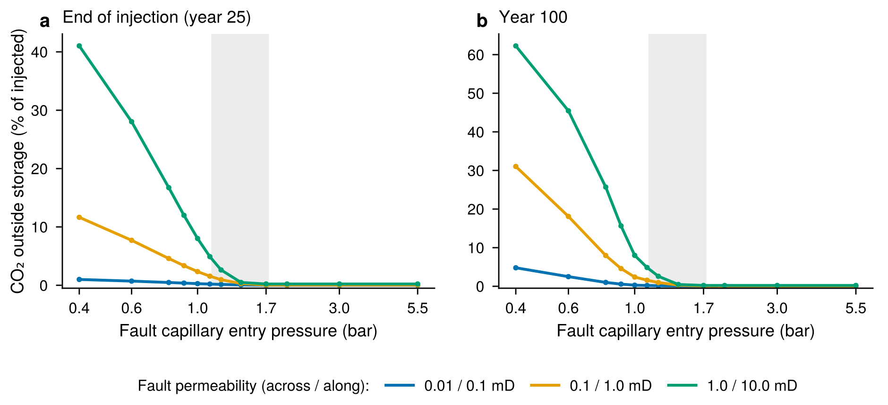

# CO2 storage in a faulted reservoir: JutulDarcy.jl simulations with verification

**Author:** Paul Tivere Benjamin · **Status:** work in progress (October 2026). This README is a draft; the research claims for the depleted-gas-field part are not final.

A sequence of small, reproducible reservoir simulations in [JutulDarcy.jl](https://github.com/sintefmath/JutulDarcy.jl) (SINTEF), built step by step to learn compositional reservoir simulation. The focus is CO2 migration across and along a fault, in a saline aquifer and in a depleted gas field. Every step pairs a model with checks of its numerical and physical consistency, and the notes record what each check found, including corrections.

## What is in the repository

| Step | Question | Main result | Notes |
|---|---|---|---|
| 1 | Build a faulted cross-section | Tilted fault block, 30 m throw > 20 m caprock → 10 m sand–sand leak window; fault as its own anisotropic zone | [01](notes/01_geometry.md) |
| 2, 2b, 2c | CO2–brine injection; effect of capillary pressure; verification | Capillary entry pressure turns fault seal into a threshold process. Boundaries, Pc range, accounting and grid resolution checked | [02](notes/02_baseline.md), [02b](notes/02b_capillary.md), [02c](notes/02c_verification.md) |
| 3 | Fault entry pressure × permeability sweep (36 runs) | Three approximate regimes: persistent leakage; injection-triggered fault invasion; capillary seal with dissolved-only transport. Entry pressure controls *whether*, permeability *how much* | [03](notes/03_sweep.md) |
| 3b | Verification of Step 3 | Conservation residual ≤ 0.34 t (tight tolerances); boundary flux integrated per ministep; time-step insensitive; grid sensitivity ~±25% in magnitudes (not converged); injection rate controls free-CO2 seal breach at fixed total mass | [03b report](notes/03b_verification_report.md) |
| 4A | Søreide–Whitson equation of state for CO2–CH4–brine (standalone) | CO2 solubility vs JutulDarcy's CO2-brine correlations; weak salting-out; Peng–Robinson brine density 15–19% low; a CH4 term discrepancy in the installed version, already fixed upstream | [04a](notes/04a_flash_benchmark.md) |
| 4B stage 1 | 1D depleted gas reservoir (CO2–CH4 Peng–Robinson, immiscible brine) | Mass conserved to ~1e-6; p/Z material balance within 0.12%, explained by connate-water expansion; mixing zone controlled by numerical dispersion | [04b](notes/04b_depleted_gas_1d.md) |
| 4B stage 2 | 2D gas–water reservoir: equilibrium and gravity | Stable initial state; CO2-rich gas collects beneath CH4 with gravity on (CO2–CH4 mean-depth difference +13 m vs −11 m with gravity off) | [04b2](notes/04b2_gas_2d.md) |
| 4C | Capillary pressure in the three-phase compositional model | Sign convention, phase ordering and per-rock-type curves verified (equilibrium slope ratio 0.9996; barrier holds and breaks at the predicted column heights) | [04c](notes/04c_pc_check.md) |
| 4B stage 2c | Faulted depleted methane field: production, then CO2 injection, with methane vs CO2-scaled capillary curves and a no-injection control | Depletion draws ~18,000 m³ of water into the trap, largely through the fault. During injection the fault's pore pressure lags the gas pressure (residual water in the gas zone is immobile; the 0.01 mD fault drains slowly), so gas crosses the fault while the reservoir is still ~28 bar below its original pressure. The control moves no gas; CO2-scaled capillary curves increase leakage (+15% with a one-cell fault, +41% with the fault resolved by 10 columns); capping injection at the original pressure reduces but does not stop it. A single 10 m fault cell overestimates leakage by 19–45% | [04d](notes/04d_fault_gas.md) |

<p align="center"></p>

*CO2 leaving the storage formation vs fault capillary entry pressure, for three fault permeabilities (Step 3). The grey band is a scenario-specific reference range of the CO2 pressure acting on the fault.*

## Models and main assumptions
- **Saline aquifer (Steps 1–3):** JutulDarcy's `:co2brine` K-value model (H2O–CO2, CO2 dissolution and water evaporation; correlations from Saló-Salgado et al. 2024), 95 °C, 30,000 mg/L NaCl-equivalent (a *hypothetical* baseline), Brooks–Corey relative permeability with Killough hysteresis, Leverett-scaled Brooks–Corey capillary pressure per facies.
- **Depleted gas field (Step 4B):** three-phase compositional model with brine as an immiscible phase and CO2–CH4 described by Peng–Robinson. Excludes gas dissolution in brine, water evaporation and diffusion.
- 2D cross-sections; isothermal; no geomechanics. Pressure results say nothing about fault slip.
- Fault properties are prescribed, not derived from geology (e.g. clay content).

## Known limitations (see each step's notes)
- Leakage magnitudes carry roughly ±25% grid sensitivity; trapping fractions are grid-dependent and are not reported as results.
- Steps 2–4 represent the 10 m fault zone with one cell across. Stage 4B-2c shows this overestimates leakage by 19–45% in the depleted-field case (5 and 10 fault columns tested), so the Step 2–3 leakage magnitudes are probably overestimated too and should be rechecked with a resolved fault (`section_spec(fault_subcells = …)`).
- JutulDarcy's mass-balance tolerance is relative to the whole model's mass (mostly brine); minor components need a tighter `tol_mb` (1e-9 is used in stage 4B-2c).
- JutulDarcy 0.3.10's open boundary flux ignores gravity across the half cell and capillary pressure.
- No molecular diffusion or mechanical dispersion; mixing widths are numerical.
- Capillary pressure is one scalar curve per cell (no directional entry pressure in the fault).

## Reproducing
Requires Julia 1.12 (via [juliaup](https://github.com/JuliaLang/juliaup)). Exact package versions are pinned in `Manifest.toml` (JutulDarcy 0.3.10, Jutul 0.4.30, MultiComponentFlash 1.1.19, CairoMakie 0.15.15).

```
julia --project=. -e "using Pkg; Pkg.instantiate()"
julia --project=. scripts/01_build_section.jl
julia --project=. scripts/02_run_cases.jl all
julia --project=. scripts/03_sweep.jl            # ~1.5–2 h on a laptop
julia --project=. scripts/03b_verify.jl flux     # also: rate, dt, grid (grid is slow)
julia --project=. scripts/04a_flash_benchmark.jl
julia --project=. scripts/04b_depletion_1d.jl
julia --project=. scripts/04b2_gas_2d.jl stability
julia --project=. scripts/04c_pc_check.jl
julia --project=. scripts/04d_fault_gas.jl runs        # depletion + branches a, b, c (~40 min)
julia --project=. scripts/04d_fault_gas.jl runs_bhp    # pressure-capped branches (~50 min)
julia --project=. scripts/04d_fault_gas.jl runs_fault5 # fault-resolution test (also runs_fault10)
julia --project=. scripts/04d_report.jl
```

Simulation outputs (`output/`) are not version-controlled; figures and summary tables are.

## Layout
- `src/`: model code (geometry, cases, run/verification helpers, gas-field fluid model)
- `scripts/`: one script per step
- `notes/`: reasoning, results, checks and corrections for each step
- `results/`, `figures/`: summary tables and figures (`figures/superseded/`: first-configuration figures from Steps 2–2b)

## Acknowledgements
JutulDarcy.jl and Jutul.jl (SINTEF Digital); MultiComponentFlash.jl.

## License
MIT (see `LICENSE`).
